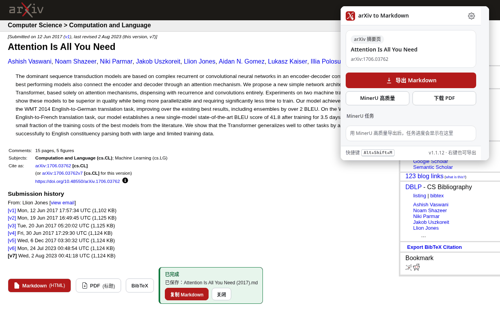
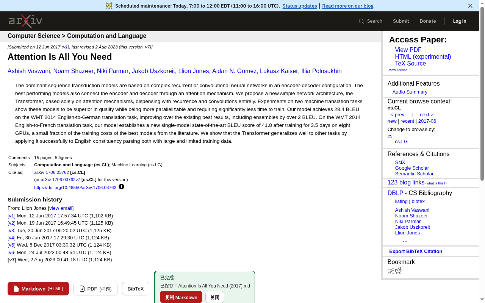
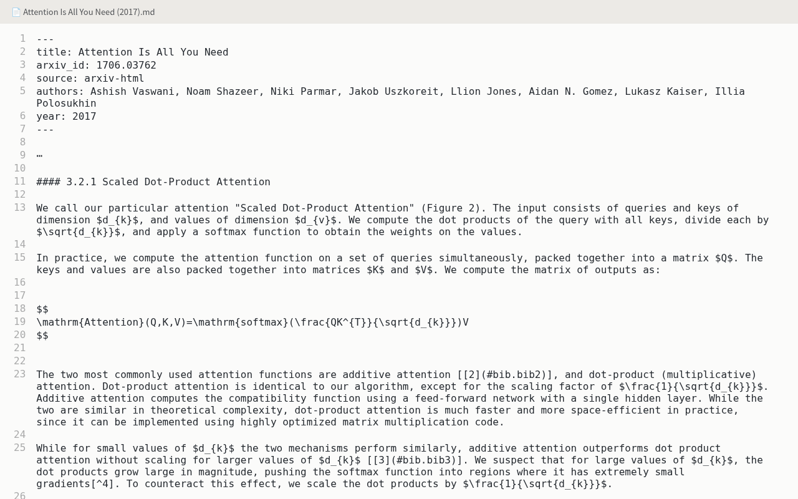
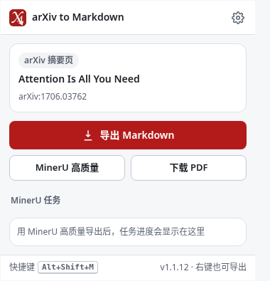
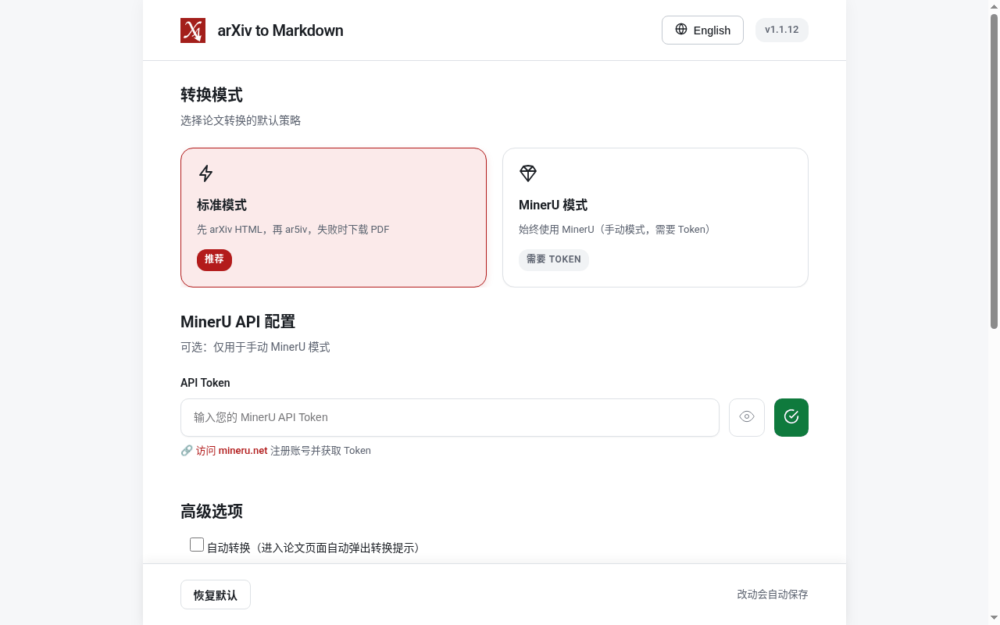

<div align="center">


# arXiv to Markdown

**把 arXiv 论文一键保存为 Markdown，PDF 自动按标题命名。**

[](https://chromewebstore.google.com/detail/arxiv-to-markdown/pphdggfbjddgdljndgdablkhbdpbfnbd)
[](./LICENSE)
[](./src/manifest.json)

[安装](https://chromewebstore.google.com/detail/arxiv-to-markdown/pphdggfbjddgdljndgdablkhbdpbfnbd) · [English](./README.md) · [常见问题](./docs/FAQ.md) · [隐私说明](./PRIVACY.md) · [更新日志](./CHANGELOG.md)

<picture>
  <source media="(prefers-color-scheme: dark)" srcset="docs/screenshots/hero-dark.png">
  
</picture>

</div>

## 功能

- **一键导出 Markdown**：在 arXiv 摘要页 `Submission history` 下方注入 `Markdown`、`PDF`、`BibTeX` 三个按钮。
- **先用官方 HTML**：优先转换 arXiv 官方 HTML 版，没有时用 ar5iv；两者都没有时下载 PDF。
- **公式和结构尽量保留**：LaTeX 公式保留为 `$...$` / `$$...$$`；简单表格转 GFM，含合并单元格的表格保留 HTML；正文引用链接到参考文献，脚注转成 `[^n]`。
- **可选 YAML frontmatter**：`title`、`arxiv_id`、`source`、`authors`、`year`，方便 Obsidian、Logseq、Zotero 之类的工具索引。
- **PDF 按标题命名**：不再是 `1706.03762.pdf`，而是 `Attention Is All You Need (2017).pdf` 这样的文件名。
- **BibTeX 一键复制**：取 arXiv 官方引用；取不到时用页面上的标题、作者和年份生成。
- **复制给 AI 或笔记**：转换成功后页面上保留结果卡片，可一键「复制 Markdown」。带操作按钮的卡片保留到手动关闭，其他已完成卡片 10 秒后收起（悬停或聚焦时暂停计时）。
- **PDF 解析（可选）**：填入你自己的 API Key 后，可把 PDF 交给设置里选定的后端在后台解析，支持 PaddleOCR（默认，免费额度）和 MinerU；PaddleOCR 结果保存为 `.md` 文件（带图片时为 ZIP 包），MinerU 保留原始 ZIP 包，任务进度在弹窗里查看。
- **多个入口**：页面按钮、工具栏弹窗、右键菜单、快捷键，PDF 页右下角还有悬浮按钮。
- **中英文界面**，支持浅色和深色模式。

| 页面内按钮 | 导出的 Markdown |
| --- | --- |
|  |  |

## 安装

**Chrome**：从 [Chrome 应用商店](https://chromewebstore.google.com/detail/arxiv-to-markdown/pphdggfbjddgdljndgdablkhbdpbfnbd) 安装。需要 Chrome 121 或更高版本。

**Edge / Firefox**：计划中，尚未上架。

**从源码加载**：

```bash
git clone https://github.com/Tendo33/arxiv-md.git
cd arxiv-md
npm install
npm run build
```

打开 `chrome://extensions`，开启「开发者模式」，点击「加载已解压的扩展程序」，选择 `dist/` 目录。

## 使用

1. 打开任意 arXiv 论文页，例如 <https://arxiv.org/abs/1706.03762>。
2. 点击页面上的 `Markdown` 按钮，按设置里的默认模式转换并下载 `.md`。
3. 也可以点击工具栏图标，在弹窗里「导出 Markdown」「PDF 解析」或「下载 PDF」。

| 入口 | 说明 |
| --- | --- |
| 页面按钮 | 摘要页 `Submission history` 下方：`Markdown`、`PDF`、`BibTeX` |
| 工具栏弹窗 | 识别当前论文，提供导出按钮、当前解析后端和 PDF 解析任务列表 |
| 快捷键 | `Alt+Shift+M`（macOS 为 `Option+Shift+M`），在摘要页、PDF 页、HTML 页转换当前论文。显示「未设置」时，弹窗里有「去设置」入口，也可以在 `chrome://extensions/shortcuts` 修改 |
| 右键菜单 | 论文页上：「导出本论文为 Markdown」「用 PDF 解析转换（后端名）」（仅在当前后端已填 Key 时显示）；arXiv 论文链接上：「导出链接指向的论文为 Markdown」 |
| PDF 页悬浮按钮 | 在 `arxiv.org/pdf/*` 页右下角，可在设置里关闭 |



## 设置



| 设置项 | 说明 |
| --- | --- |
| 转换模式 | `标准模式`（推荐）：官方 HTML → ar5iv → PDF；`PDF 解析模式`：始终用当前选定的后端做 PDF 解析，需要对应的 Key |
| PDF 解析 | 选择后端（默认 PaddleOCR，也可选 MinerU）并填写对应的 API Key；Key 只存在本机 `chrome.storage.local`，不会同步；可在设置页测试连接 |
| 自动转换 | 进入论文页时弹出转换提示 |
| Markdown 元数据 | 是否写入 YAML frontmatter |
| 桌面通知 | PDF 解析任务完成或失败时通知 |
| PDF 页悬浮按钮 | 是否在 PDF 页显示悬浮转换按钮 |
| 界面语言 | 中文 / English |
| 使用统计 | 转换次数等计数存在 `chrome.storage.sync`（开启浏览器同步时会随账号同步），不会上传，可一键重置 |

设置改动会自动保存。

## 权限说明

| 权限 | 用途 |
| --- | --- |
| `storage` | 设置（含选定的 PDF 解析后端）和使用统计存在 `chrome.storage.sync`，开启浏览器同步时会随浏览器账号同步；各后端的 API Key 和 PDF 解析任务状态存在 `chrome.storage.local`，只留在本机。旧版本存在同步区的 MinerU Key 会移到本机（先复制到 local，再从同步区删除）；Key 不跨设备同步，其他设备上会提示在本设备重新填写 Key |
| `downloads` | 把 Markdown、PDF 或 PDF 解析结果 保存到本地 |
| `activeTab` | 读取你当前打开的 arXiv 页面，用于转换 |
| `notifications` | PDF 解析任务完成或失败时发桌面通知 |
| `alarms` | PDF 解析任务进行中时定时唤醒后台、轮询进度 |
| `contextMenus` | 提供右键菜单入口 |
| `arxiv.org`、`export.arxiv.org` | 读取论文 HTML、元数据和 PDF |
| `ar5iv.org`、`ar5iv.labs.arxiv.org` | 官方 HTML 不可用时读取 ar5iv 版本 |
| `mineru.net`、`cdn-mineru.openxlab.org.cn` | 仅在你使用 MinerU 时提交任务、下载结果 |
| `paddleocr.aistudio-app.com`（可选） | 仅在你选择 PaddleOCR 时申请，可在设置页撤销 |
| `*.bj.bcebos.com`（可选） | 与 PaddleOCR 访问权限一起申请；PaddleOCR 的解析结果和图片从这个百度存储域名下载 |
| `declarativeNetRequestWithHostAccess`（可选） | 与 PaddleOCR 访问权限一起申请，只去掉发往该域名请求的 `Origin` 头 |
| 内容脚本：`arxiv.org/abs/*`、`arxiv.org/pdf/*`、`arxiv.org/html/*` | 在这些页面注入导出按钮、结果卡片和 PDF 页悬浮按钮 |

## 隐私

- 扩展没有自己的服务器，不收集、不上传你的数据，也没有统计或埋点。
- 标准模式下，转换完全在你的浏览器里完成，只访问 arXiv 和 ar5iv。
- 只有你主动使用 PDF 解析时，论文才会和你的 Key 一起发给你选定的那一个后端（PaddleOCR 或 MinerU，均为第三方服务，受其条款约束）：MinerU 收到 arXiv PDF 链接；PaddleOCR 收到 arXiv PDF 文件本身（上传，50 MB 以内），非 arXiv 的 PDF 只发链接；超过 50 MB 的 PDF 不会发送，扩展会提示改用 MinerU。扩展不会自动切换后端。
- 解析服务如何处理和保留你提交的内容由其自身条款决定。百度 AI Studio（PaddleOCR）和 MinerU 目前都没有公开上传文件和解析结果的具体保留期限；AI Studio 隐私政策只写了"在提供服务所需的期限内保存"。请不要发送你无权分享给第三方的 PDF。
- 详见 [PRIVACY.md](./PRIVACY.md)。

## 常见问题

**为什么有的论文导出的是 PDF？**
官方 HTML 和 ar5iv 都没有这篇论文的可转换版本时，标准模式会回退为下载 PDF。想要 Markdown 可以改用 PDF 解析。

**图片会下载到本地吗？**
不会。Markdown 里的图片是指向 arXiv / ar5iv 的远程链接。

**快捷键显示「未设置」？**
通常是被其他扩展或浏览器占用。点击弹窗里的「去设置」，或打开 `chrome://extensions/shortcuts` 自行指定。

**MinerU 导出的为什么是 ZIP？**
MinerU 返回的结果包包含 Markdown 和图片等文件，扩展按原样保存。

更多见 [docs/FAQ.md](./docs/FAQ.md)。

## 开发

```bash
npm install
npm run dev       # 监听构建
npm run build     # 输出未打包扩展到 dist/
npm run lint
npm test
npm run package   # 生成 build/arxiv-md-v<version>.zip
```

架构见 [docs/ARCHITECTURE.md](./docs/ARCHITECTURE.md)，开发和发版见 [docs/DEVELOPMENT.md](./docs/DEVELOPMENT.md)，贡献方式见 [CONTRIBUTING.md](./CONTRIBUTING.md)。

## 更新日志

见 [CHANGELOG.md](./CHANGELOG.md)。

## License

[MIT](./LICENSE)
